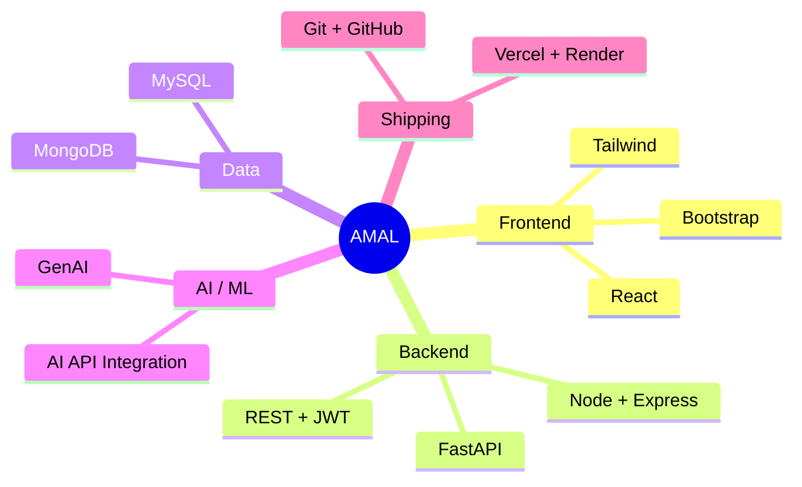

<p align="center">
  
</p>

<p align="center">
  
</p>

<p align="center">
  
  
  
</p>

<p align="center">
  <a href="https://www.linkedin.com/in/amal-vishnu-g-a8a0033b5"></a>
  <a href="mailto:amalvishnu21702@gmail.com"></a>
  <a href="https://github.com/Amal-vishnu04"></a>
</p>

<p align="center">
  
</p>

<p align="center">
  
</p>

---

### ⟦ 01 // TECH_ARSENAL ⟧

<p align="center">
  
</p>

### ⟦ 02 // SKILL_TREE ⟧



### ⟦ 03 // FEATURED_PROJECTS ⟧

<table>
  <tr>
    <td width="50%" valign="top">
      <h4>🌱 <a href="https://github.com/Amal-vishnu04/Foodbridge">Foodbridge</a></h4>
      Fighting food waste with technology: track inventory, donate surplus food, analyze waste patterns in real time.
      <br><br><code>JavaScript</code> <code>MERN</code>
    </td>
    <td width="50%" valign="top">
      <h4>🛰️ <a href="https://github.com/Amal-vishnu04/Atmosguard">Atmosguard</a></h4>
      AI/ML-powered weather station anomaly detection.
      <br><br><code>Python</code> <code>AI/ML</code>
    </td>
  </tr>
  <tr>
    <td valign="top">
      <h4>🗓️ <a href="https://github.com/Amal-vishnu04/AttendanceSystem">AttendanceSystem</a></h4>
      Full-stack attendance management app.
      <br><br><code>JavaScript</code>
    </td>
    <td valign="top">
      <h4>📝 <a href="https://github.com/Amal-vishnu04/Blogwebsite">Blogwebsite</a></h4>
      Responsive blog frontend built with HTML, CSS and JavaScript.
      <br><br><code>HTML</code> <code>CSS</code> <code>JS</code>
    </td>
  </tr>
</table>

### ⟦ 04 // ACTIVE_PROCESSES ⟧

```text
 PID   STATUS     PROCESS
 101   RUNNING    Advanced MERN Stack Architecture
 102   RUNNING    AI API Integration & Intelligent Workflows
 103   RUNNING    FastAPI Development
 104   RUNNING    Cloud Computing & DevOps Fundamentals
 105   RUNNING    Machine Learning & Automation
```

### ⟦ 05 // MISSION_LOG ⟧

```diff
+ [2025-12 → 2026-01]  Development Intern @ Brainery Spot Technology
  - Hands-on exposure to real engineering workflows
  - Built web app components, team communication & discipline
```

### ⟦ 06 // ACHIEVEMENTS_UNLOCKED ⟧

```diff
+ 🥇 [ACCESS GRANTED]  Internal Smart India Hackathon (SIH) 2026 — Team Winner
+ 🥈 [ACCESS GRANTED]  Bench Press Competition (2022) — 2nd Place
```

### ⟦ 07 // LIVE_TELEMETRY ⟧

<p align="center">
  
</p>

<p align="center">
  
</p>

---

<details>
<summary><code>$ sudo ./reveal_secret.sh</code> 🔐 (click if you dare)</summary>

```text
[sudo] password for visitor: ********
ACCESS GRANTED ✔
> Secret #1 : Bench press is my other compiler 🏋️
> Secret #2 : Hire me, I ship fast 😎
```

</details>

<p align="center">
  
</p>

<p align="center">
  <code>$ echo "Always learning. Always building. Always improving." && exit 0</code>
</p>
